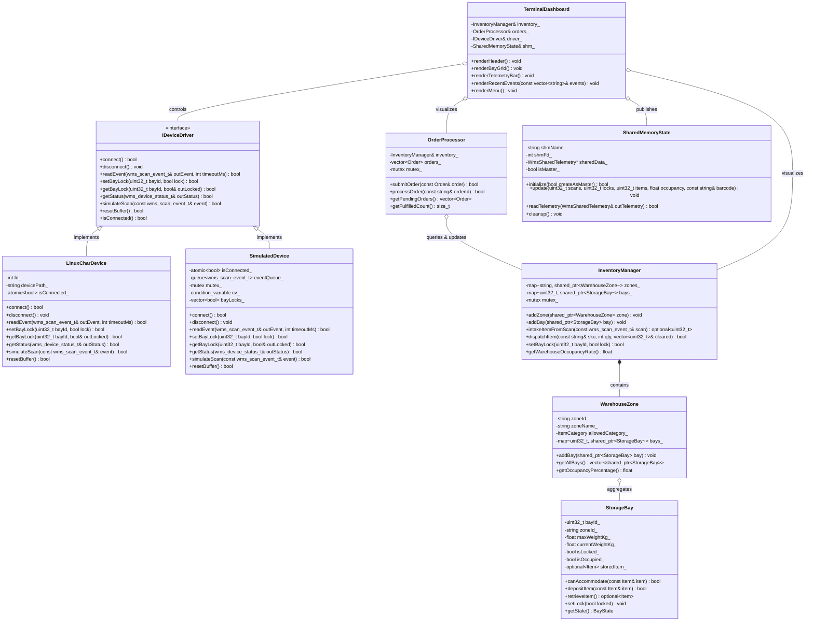
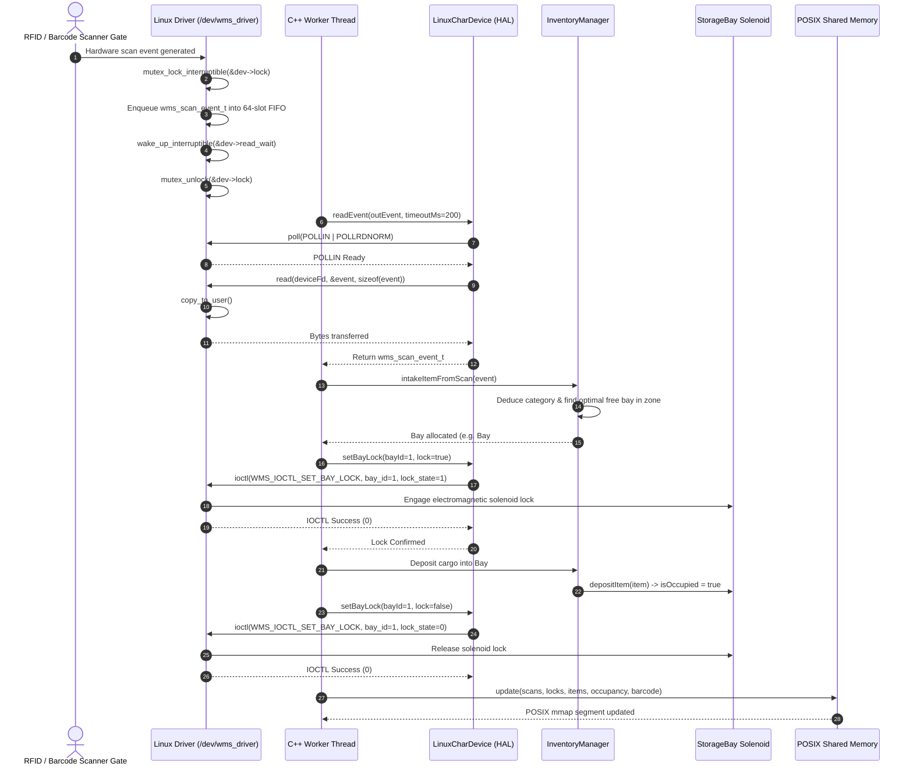

# Warehouse Management System (WMS)
### Using a Linux Character Device Driver, System Programming & Modern C++

[](https://kernel.org)
[](https://isocpp.org)
[]()
[]()

An industrial-grade individual engineering project demonstrating an end-to-end software development lifecycle across **Linux Device Drivers**, **System Programming (POSIX APIs)**, and **Modern C++ Object-Oriented Architecture**.

---

## 📑 6-Stage Project Lifecycle & Documentation

This project follows a rigorous 6-stage engineering development process. Full documentation for each stage is available in the [`docs/`](docs/) directory:

| Stage | Milestone | Report File | Key Contents |
|---|---|---|---|
| **Stage 1** | Project Introduction | [`docs/STAGE1_PROJECT_INTRODUCTION.md`](docs/STAGE1_PROJECT_INTRODUCTION.md) | Problem formulation, industrial motivation, project scope, expected outcomes |
| **Stage 2** | Requirements & PRD | [`docs/STAGE2_REQUIREMENTS_PRD.md`](docs/STAGE2_REQUIREMENTS_PRD.md) | Functional & Non-functional requirements, PRD, deliverables matrix, Gantt roadmap |
| **Stage 3** | System Architecture | [`docs/STAGE3_SYSTEM_ARCHITECTURE.md`](docs/STAGE3_SYSTEM_ARCHITECTURE.md) | 3-Tier architecture, UML Class Diagram, Sequence Diagram, State Machine |
| **Stage 4** | Prototype Implementation | [`docs/STAGE4_INITIAL_PROTOTYPE.md`](docs/STAGE4_INITIAL_PROTOTYPE.md) | Kernel driver implementation, HAL dual-mode, core domain prototype |
| **Stage 5** | Testing & Integration | [`docs/STAGE5_TESTING_AND_INTEGRATION.md`](docs/STAGE5_TESTING_AND_INTEGRATION.md) | Test suites, benchmarks, safety interlock bug fixes, memory verification |
| **Stage 6** | Final Delivery & Presentation | [`docs/STAGE6_FINAL_REPORT_PRESENTATION.md`](docs/STAGE6_FINAL_REPORT_PRESENTATION.md) | Final system evaluation, live demonstration walkthrough, future expansions |

---

## 🏛️ System Architecture

```
+-------------------------------------------------------------------------+
|                    INTERACTIVE TERMINAL UI / DASHBOARD                  |
|                (ANSI Color Grid, Live Event Logs, Menu)                 |
+------------------------------------+------------------------------------+
                                     │
+------------------------------------▼------------------------------------+
|                         WAREHOUSE CORE ENGINE                           |
|        (InventoryManager, StorageBay, WarehouseZone, OrderProcessor)    |
+-------------------+--------------------------------+--------------------+
                    │                                │
+-------------------▼------------------+   +---------▼--------------------+
|      SYSTEM PROGRAMMING LAYER        |   |  HARDWARE ABSTRACTION LAYER  |
|  - POSIX Shared Memory (/wms_telemetry)  |  - IDeviceDriver Interface   |
|  - POSIX Signal Handling (SIGINT/TERM)   |  ├── LinuxCharDevice         |
|  - Multi-threaded Worker Pool (std::thread)| └── SimulatedDevice (Mock) |
+--------------------------------------+   +-------------------+----------+
                                                               │
========================= LINUX VFS SYSCALLS ==================│===========
                     open() / read() / write() / ioctl() / poll()
===============================================================│===========
                                                               │
+--------------------------------------------------------------▼----------+
|                  LINUX KERNEL CHARACTER DEVICE DRIVER                   |
|                            (/dev/wms_driver)                            |
|  - Dynamic cdev Allocation        - Kernel Mutex & Wait Queues          |
|  - Circular Event FIFO Buffer     - Custom IOCTL Command Dispatcher     |
+-------------------------------------------------------------------------+
```

---

## 📐 UML Diagrams

### 1. UML Class Diagram
The Class Diagram models the object-oriented architecture, the Hardware Abstraction Layer (HAL), and domain entities:



---

### 2. UML Sequence Diagram: Hardware Scan Intake & Bay Locking
Illustrates the interaction flow from the physical RFID/barcode scanner gate through the Linux kernel driver, wait queues, userspace C++ worker thread, automatic zone placement, electromagnetic solenoid actuation via IOCTL, and POSIX shared memory updates:



---

### 3. UML State Machine Diagram: Storage Bay Operational Lifecycle
Captures the state transitions of individual warehouse storage bays, including hardware electromagnetic interlocks and safety protections:

```mermaid
stateDiagram-v2
    [*] --> EMPTY_UNLOCKED: Bay Initialized

    EMPTY_UNLOCKED --> LOCKING_FOR_INTAKE: Scan Detected (write/IOCTL)
    note right of LOCKING_FOR_INTAKE: Solenoid engaged via WMS_IOCTL_SET_BAY_LOCK

    LOCKING_FOR_INTAKE --> OCCUPIED_LOCKED: Pallet Deposited & Load Cell Calibrated
    OCCUPIED_LOCKED --> OCCUPIED_SECURE: Placement Verified & Solenoid Released
    note right of OCCUPIED_SECURE: Normal secure holding state

    OCCUPIED_SECURE --> LOCKING_FOR_PICK: Customer Order Pick Requested
    LOCKING_FOR_PICK --> PICKING_IN_PROGRESS: Solenoid Released & Goods Retrieved
    PICKING_IN_PROGRESS --> EMPTY_UNLOCKED: Pallet Removed & Weight Scale Zeroed

    OCCUPIED_SECURE --> MAINTENANCE_LOCKED: Manual Maintenance Lock (IOCTL)
    MAINTENANCE_LOCKED --> OCCUPIED_SECURE: Maintenance Completed & Lock Released

    note left of MAINTENANCE_LOCKED: Safety Interlock: Order fulfillment is strictly blocked while locked
```

---

## 🖥️ Interactive Web & Terminal Dashboards

This project provides two interfaces for real-time monitoring and control:

1. **Interactive Web Dashboard (`web/index.html`)**:
   - Modern browser-based 24-bay dynamic rack layout with live color coding (Empty, Occupied, Locked).
   - Interactive clickable padlocks to toggle electromagnetic solenoid locks via IOCTL.
   - Cargo intake scanner simulation, order dispatching with safety interlocks, and POSIX shared memory inspector.
   - Launch with `make dashboard` or double-click [`web/index.html`](web/index.html).

2. **Interactive Terminal Console Dashboard (`./build/wms_app`)**:
   - High-performance ANSI color terminal dashboard with live 24-bay grid, telemetry bar, event stream, and interactive menu.

---

## 🚀 Quick Start Guide

### 1. Prerequisites (Ubuntu / Linux / WSL2)
Install the standard build essentials, Linux kernel headers, and CMake:
```bash
sudo apt update
sudo apt install -y build-essential cmake linux-headers-$(uname -r)
```

### 2. Build Everything
Build both the Linux Character Device Driver (`wms_driver.ko`) and the C++ application suite:
```bash
make
```

### 3. Run Automated Tests
Execute the unit, integration, and stress test suites:
```bash
make test
# or manually:
./build/tests/wms_tests
```

### 4. Run Automated End-to-End System Demo
Run the automated end-to-end demonstration showcasing cargo intake, zone allocation, safety interlock bay locking, customer order fulfillment, and POSIX shared memory telemetry:
```bash
make demo
# or manually:
./build/wms_app --demo
```

### 5. Launch Interactive Terminal Dashboard
Launch the interactive ANSI dashboard to manually trigger scans, dispatch orders, actuate bay locks via IOCTL, and inspect telemetry:
```bash
./build/wms_app
```

### 6. Launch Interactive Web Dashboard
```bash
make dashboard
# or open web/index.html in any browser
```

---

## 🔌 Kernel Device Driver & IOCTL Interface

The driver exposes the character device node at `/dev/wms_driver`. The shared header [`driver/include/wms_ioctl.h`](driver/include/wms_ioctl.h) defines the hardware control contract:

| IOCTL Command | Direction | Payload Structure | Description |
|---|---|---|---|
| `WMS_IOCTL_GET_STATUS` | `_IOR` | `wms_device_status_t` | Reads driver metrics (total scans, buffer occupancy, dropped events, active locks). |
| `WMS_IOCTL_SET_BAY_LOCK` | `_IOW` | `wms_bay_lock_req_t` | Actuates electromagnetic solenoid lock on target bay ID. |
| `WMS_IOCTL_GET_BAY_LOCK` | `_IOWR` | `wms_bay_lock_req_t` | Queries hardware lock state of target bay ID. |
| `WMS_IOCTL_SIMULATE_SCAN` | `_IOW` | `wms_scan_event_t` | Injects hardware scan telemetry directly into the kernel ring buffer. |
| `WMS_IOCTL_RESET_BUFFER` | `_IO` | None | Resets ring buffer pointers and clears dropped event counters. |

### Loading the Kernel Module
On a Linux machine / VM with matching kernel headers:
```bash
# Build & insert driver
sudo ./scripts/load_driver.sh

# Verify loaded module
lsmod | grep wms_driver
ls -la /dev/wms_driver

# Unload driver when finished
sudo ./scripts/unload_driver.sh
```
> **Note on Portability (Dual-Mode HAL)**: If running in WSL2 without a custom-compiled kernel or in a non-root environment where `insmod` is unavailable, the C++ application automatically detects this and falls back seamlessly to the in-memory `SimulatedDevice` HAL driver, allowing full application and integration testing without compromise!

---

## 📁 Repository Directory Structure

```
warehouse-management-system/
├── CMakeLists.txt                # CMake project build definitions
├── Makefile                      # Top-level unified orchestrator
├── README.md                     # Master project guide
├── .gitignore                    # Git exclusions
├── driver/                       # Linux Character Device Driver
│   ├── Makefile                  # Kernel module makefile
│   ├── wms_driver.c              # Device driver source (cdev, fops, ioctl)
│   ├── wms_driver.h              # Kernel driver state structures
│   └── include/
│       └── wms_ioctl.h           # Shared IOCTL codes & structures
├── include/                      # C++ Header Files
│   ├── core/                     # InventoryManager, StorageBay, WarehouseZone, OrderProcessor
│   ├── hal/                      # IDeviceDriver, LinuxCharDevice, SimulatedDevice
│   ├── ipc/                      # SharedMemoryState, SignalDispatcher
│   └── ui/                       # TerminalDashboard (ANSI UI)
├── src/                          # C++ Implementations
│   ├── core/
│   ├── hal/
│   ├── ipc/
│   ├── ui/
│   └── main.cpp                  # Entry point
├── web/                          # Interactive Web Dashboard
│   └── index.html                # Visual 24-bay browser interface
├── tests/                        # Comprehensive Test Suites
│   ├── CMakeLists.txt
│   ├── test_inventory.cpp
│   ├── test_device_driver.cpp
│   └── test_ipc_signals.cpp
├── scripts/                      # Automation & Utility Scripts
│   ├── load_driver.sh
│   ├── unload_driver.sh
│   ├── simulate_scans.sh
│   ├── open_dashboard.sh
│   └── run_demo.sh
└── docs/                         # Formal 6-Stage Reports
    ├── STAGE1_PROJECT_INTRODUCTION.md
    ├── STAGE2_REQUIREMENTS_PRD.md
    ├── STAGE3_SYSTEM_ARCHITECTURE.md
    ├── STAGE4_INITIAL_PROTOTYPE.md
    ├── STAGE5_TESTING_AND_INTEGRATION.md
    └── STAGE6_FINAL_REPORT_PRESENTATION.md
```

---

## 👨‍💻 Git Progression & Commits
Progressive commits demonstrate continuous evolution across each stage:
- `Stage 1`: Problem formulation, introduction, and scope definition.
- `Stage 2`: PRD, functional/non-functional requirements, and project timeline.
- `Stage 3`: System architecture, UML Class/Sequence/State diagrams, and repo setup.
- `Stage 4`: Kernel driver implementation, C++ HAL, and prototype event intake.
- `Stage 5`: Comprehensive test suite, safety interlock enhancements, and performance optimizations.
- `Stage 6`: Final working project, terminal dashboard, demo automation, and presentation report.

---

## 📄 License
This project is developed as an academic individual engineering project and is licensed under the **GPL-2.0 / MIT Dual License**.
